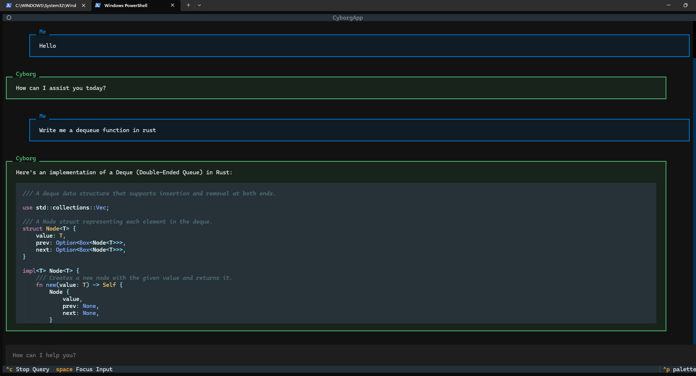

# CLI Helper Tool

A CLI helper tool that helps with day-to-day commands and automates software development tasks. This tool provides configuration management and a CLI-friendly cyborg tool for other tasks.

## Installation

To install this tool via **pip**, run:

```bash
pip install retan
pip install --editable .
```

Alternatively, if you are using Poetry, run:

```bash
poetry install
```

### `cyborg` - A CLI friendly cyborg tool

The `cyborg` command provides a simple cyborg tool to run a specific CLI-friendly app.



#### Subcommands

- **`run`**: Run the Cyborg app.

  Usage:
  ```bash
  pilot cyborg run
  ```
  

 **Note:** It requires ollama package downloaded and run locally. To do so, you can run these commands
```shell
pip install ollama
ollama pull llama3.2
```
for now it defaults to llama3.2. in future it will be more customisable.
 